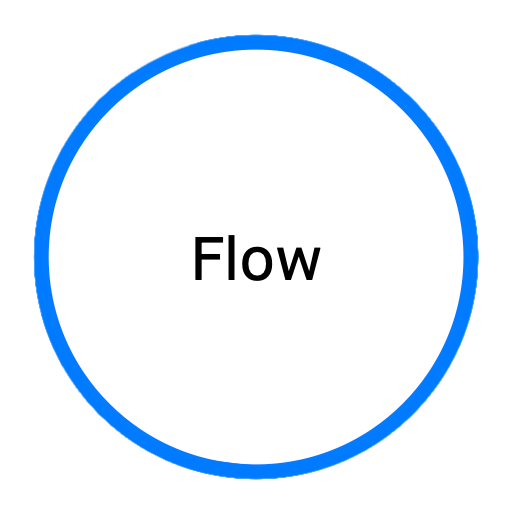

<p align="center">
  <a href="https://github.com/darkwood-com/darkwood-php-component-flow">
    
  </a>
</p>

## Why ?

Flow concept aims to solve

- Adopt asynchronous as native implementation
- Build your code with functional programming
- Assemble your code visually

## Installation

Flow requires PHP 8.6 or later in the PHP 8 series. Install the library with [Composer](https://getcomposer.org/).

```bash
composer require darkwood/flow
```

## Upgrade from Flow 8.1

Flow `v8.1.6` is the latest published release whose manifest allows PHP 8.5. Keep `darkwood/flow: ^8.1.6` and the existing lockfile in PHP 8.5
applications. The PHP 8.6 line requires a new major release.

When upgrading an application to PHP 8.6, update its Composer PHP platform,
resolve dependencies with the target binary, and run
`composer check-platform-reqs` in the deployment runtime. Existing jobs, `Ip` payloads,
error handlers and the default Fiber driver use the same API. Partial
applications and `PollDriver` are opt-in. For the generator stream drivers,
pass positive intervals to `tick()` in seconds, including fractional values.

If an aggregate declares `replace: darkwood/flow`, Composer can satisfy the
requirement without reading Flow's own manifest. Verify that the aggregate's
PHP constraint also requires 8.6 before publishing it with this version of Flow.

## Usage

```php
<?php

use Flow\Flow\Flow;
use Flow\FlowFactory;
use Flow\Ip;

class D1 {
    public function __construct(public int $n1) {}
}

class D2 {
    public function __construct(public int $n2) {}
}

class D3 {
    public function __construct(public int $n3) {}
}

class D4 {
    public function __construct(public int $n4) {}
}

$flow = (new FlowFactory())->create(static function() {
    yield fn (D1 $data1) => new D2($data1->n1 += 1);
    yield fn (D2 $data2) => new D3($data2->n2 * 2);
    yield function(D3 $data3) {
        printf("my number %d\n", $data3->n3); // displays "my number 10"

        return new D4($data3->n3);
    };
});

$ip = new Ip(new D1(4));
$flow($ip);
$flow->await();
```

## Partial function application

PHP 8.6 produces native closures from calls that use argument placeholders. Pass
them directly to `FlowFactory` or `fn()`. Each step receives the value in
`Ip::$data`, including the returned value from the previous step. Fix every
required argument except the one supplied by Flow.

```php
$flow = (new FlowFactory())->create(static function () {
    yield substr(?, offset: 1);
    yield strtoupper(...);
    yield static function (string $value): void {
        echo $value, PHP_EOL;
    };
});
$flow(new Ip('flow'));
$flow->await(); // LOW
```

## Native stream polling

Use `new Flow\Driver\PollDriver()` for cooperative generator jobs that yield
`waitReadable()`, `waitWritable()` or `waitDelay()`. PHP selects the native
backend by default. Wait timeouts are expressed in seconds and return `false`
on expiry. Flow uses a monotonic clock and passes a `Time\Duration` to PHP's
polling API. Periodic callbacks use seconds, including fractional intervals. Jobs own their streams and perform non-blocking reads and writes.

`PollDriver` and `StreamSelectDriver` share wait tokens. The set of pollable
streams depends on the native backend. `FiberDriver` remains the default.

## Error semantics

For backward compatibility, exceptions thrown by a job are resolved by the
driver as `Flow\Exception\RuntimeException` values. If a step defines an
`errorJob`, that job receives the value. Otherwise the value continues to the
next step like any other result; `await()` does not throw it automatically.
Callback, listener and runtime failures remain infrastructure exceptions.
Completion paths release their Flow-owned IP state before `await()` propagates
the failure. Native descriptor registration and wait failures reach `await()`
as infrastructure exceptions. Jobs can opt into `StreamErrorMode::Exception`
on streams they own. Their resulting `StreamException` is preserved as the
previous exception in Flow's job error value.

## Examples

A working script is available in the bundled `examples` directory

- Native closures with placeholders · `php examples/flow-partial-application.php`
- Local polling, timeout and structured errors · `php examples/flow-poll.php`
- Run Flow : `php examples/flow.php`
- Run Y-Combinator Flow : `php examples/yflow.php`
- Start Server : `php examples/server.php`  
  Start Client(s) : `php examples/client.php`

## Documentation

[https://flow.darkwood.com/](https://flow.darkwood.com/)

## License

Flow is released under the MIT License.

## Shared PHP development environment

The Flow shell imports the locked Navi environment with the canonical Composer
and quality tools. It starts no local service and passes no project sources to
Nix. Development no longer uses the Flow Docker configuration.

From the Flow directory, enter the shell with OpenSwoole enabled for the
development dependencies and tests.

```sh
nix --extra-experimental-features 'nix-command flakes' develop \
  --file tools/env/shell.nix --argstr naviEnv "$(cd ../Navi/tools/env && pwd -P)" \
  --arg withOpenSwoole true
composer install
phpunit -c tools/phpunit/phpunit.dist.xml
```

With Castor already available, use `composer env -- --with-open-swoole`.
The OpenSwoole extension is optional for users of other drivers. An extracted
Flow checkout can use `DARKWOOD_NAVI_ENV_DIR` with Castor or pass `naviEnv`
directly to Nix. Both take the absolute `tools/env` path from a pinned Navi
checkout. Composer installations of the library itself require no Navi
checkout.
